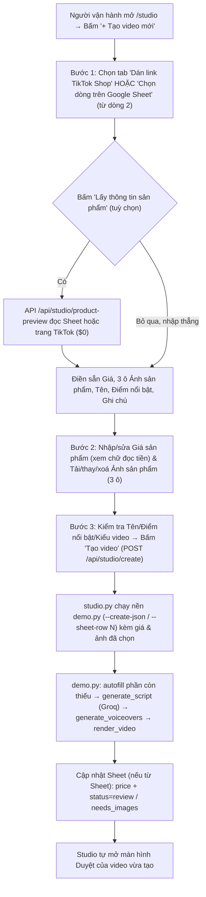

# DR-0007: Màn hình tạo video sản phẩm mới trên Studio (nhập link TikTok / số dòng Sheet, thêm ảnh, nhập/sửa giá)

| Trạng thái | Ngày | Đề xuất | Duyệt |
|-----------|------|---------|-------|
| ✅ Đã duyệt | 2026-11-14 | Claude (BA + MKTG) | @chungkhoantony1983 |

Capability: `video-render`, `script-gen` · Nhánh: `feat/studio-create-video` · Domain workflow: `feature`

Vai trò: **BA** = phân tích yêu cầu, chi phí, viết DR & cập nhật tài liệu · **Dev** = lập trình trong worktree · **Reviewer** = soát diff, bảo mật, ràng buộc · **Tester** = kiểm thử theo bảng quyết định (trên bản sao/tạm, edge-tts, không đụng Gemini/Drive/Sheet/TikTok thật) · **MKTG** = đánh giá độ dễ dùng giao diện và thông báo cho người vận hành không rành kỹ thuật.

---

## Bối cảnh

**Vấn đề (gốc rễ)**:
Hiện tại trang Studio (`http://127.0.0.1:8000/studio`, triển khai ở DR-0001) chỉ cho phép **duyệt và sửa các video đã tạo sẵn** trong `storage/videos/`. Muốn tạo một video sản phẩm mới, người vận hành vẫn phải quay ra cửa sổ Terminal và gõ lệnh CLI:
- Chạy `demo.py --sheet` thì máy quét **toàn bộ** các dòng đang có `status` trống trên Google Sheet, không thể chọn đích danh 1 dòng cụ thể (ví dụ dòng số 5) hoặc làm lại nhanh 1 dòng mà không phải mở Google Sheet xoá cột `status`.
- Muốn làm nhanh 1 video từ link TikTok Shop mà chưa kịp vào Google Sheet thì phải gõ lệnh dài `demo.py --product ... --price ... --images ... --url ...`, hơn nữa nhánh `--product` hiện tại trong `demo.py` không tự gọi `autofill_row` (`fetch_tiktok_product` + `extract_product_facts`).
- **Ảnh sản phẩm**: Trang sản phẩm TikTok Shop thường chặn truy cập tự động bằng captcha (`TODO.md` §5); link rút gọn `vt.tiktok.com/...` đôi khi chỉ lấy được 1 ảnh hoặc không lấy được ảnh nào. Trên Terminal, người vận hành phải tải ảnh về máy, tự chép đường dẫn file vào câu lệnh hoặc tải ảnh lên nơi khác lấy link dán vào Sheet.
- **Giá sản phẩm**: Giá tự đọc từ TikTok Shop (`min_sku_price`) hay bị lệch sang giá của phân loại phụ kiện rẻ nhất hoặc giá flash sale tạm thời, hoặc trống do bị chặn captcha. Ngoài ra, nếu giá bị sai ngay lúc tạo video thì Groq sẽ viết kịch bản theo giá sai và Gemini TTS đọc luôn câu thoại đó (tốn 4/10 lượt Gemini miễn phí trong ngày). Đồng thời, trên `studio.html` hiện tại, ô sửa giá dùng `<input type="number">` + `parseInt($("#price").value, 10)` khiến người dùng gõ/dán `189.000` (có dấu chấm phân cách hàng nghìn) bị cắt thành `189` đồng, hoặc gõ thiếu/thừa số `0` mà khó phát hiện bằng mắt thường.

**Người dùng được lợi**:
Người vận hành không rành kỹ thuật — có thể thực hiện trọn vẹn quy trình **Tạo video mới → Xem & Sửa → Duyệt & Lưu** ngay trên một trang web `/studio` duy nhất (cả máy tính và điện thoại), không cần mở Terminal gõ lệnh hay sửa đường dẫn file thủ công.

**Cái gì đã có sẵn**:
- `product_sources.py`: `ProductSheet` (đọc/cập nhật Google Sheet tab `Tiktok`, mỗi dòng có `_row = i + 2` tương ứng đúng số dòng trên Google Sheet) và `fetch_tiktok_product(url)` (đọc tên, giá, ảnh gốc, mô tả, thông số từ trang TikTok Shop).
- `demo.py`: `autofill_row()`, `extract_product_facts()` (Groq), `generate_script()` (Groq), `generate_voiceovers()` (Gemini TTS / edge-tts), `render_video()` (Pillow + FFmpeg), `_load_image()` (đã hỗ trợ đọc ảnh `anh_sp_N.<ext>` nằm trong thư mục video).
- `backend/app/api/studio.py` + `studio.html`: cơ chế chạy 1 tiến trình `demo.py` nền (`_start_job`, `GET /api/studio/job`), tải ảnh dạng raw bytes kiểm tra bằng Pillow (`_sniff_image`, tối đa 15 MB, không cần `python-multipart`), bảo vệ CSRF/DNS-rebinding bằng header `X-Studio: 1` và kiểm tra `Host`.

**Cái gì còn thiếu**:
1. Màn hình **Tạo video mới** ngay trên `/studio` cho phép chọn nguồn từ **Link TikTok Shop** hoặc **Số dòng trên Bảng tính Google Sheet**.
2. Khả năng xem trước thông tin lấy được (tên, giá, ảnh, điểm nổi bật) và **tải ảnh sản phẩm từ máy lên làm đầu vào** ngay trên màn hình tạo video (tối đa 3 ảnh, kết hợp hoặc thay thế ảnh lấy từ link/Sheet).
3. Ô **nhập hoặc sửa giá sản phẩm** trước khi tạo video (và cải thiện ô giá khi sửa video) đảm bảo: dùng `<input type="text" inputmode="numeric">` tự lọc chữ số từ định dạng tiền Việt (`189000`, `189.000`, `189,000đ`), hiện xem trước số tiền kèm chữ đọc tiền tiếng Việt, chặn giá lỗi (`1..999đ`), ghi đè nhất quán vào Google Sheet, prompt kịch bản Groq, `product.json`, nhãn giá đỏ trên cảnh sản phẩm & cảnh CTA, và `post.txt`.
4. Cờ CLI mới trong `demo.py` (`--sheet-row <số dòng>`, `--create-json <file>`) để `studio.py` gọi qua subprocess đúng chuẩn `C-0001-2`.

**Đánh giá chi phí (P02)**:
- **Đọc dòng trên Google Sheet / Lấy thông tin từ link TikTok (`ProductSheet`, `fetch_tiktok_product`)**: **$0** (Google Sheets API miễn phí, HTTP GET trang công khai).
- **Tải ảnh sản phẩm từ máy & lưu vào thư mục video**: **$0** (xử lý local bằng Pillow).
- **Trích xuất thông tin sản phẩm (`extract_product_facts`) & Viết kịch bản (`generate_script`)**: **$0** (Groq API free tier, model mặc định `qwen/qwen3.8-27b`).
- **Tạo giọng đọc (`generate_voiceovers`)**:
  - Mặc định dùng **Gemini TTS** (`gemini-3.8-flash-tts`, dự phòng `gemini-3.1-flash-tts-preview`, `gemini-2.5-flash-preview-tts`): Free tier giới hạn **10 lượt/ngày/model**; mỗi video sản phẩm mới tiêu tốn khoảng **4 lượt**. Khi hết quota, cả video tự động chuyển sang **edge-tts** (**$0**, không giới hạn).
  - Việc cho phép kiểm tra/sửa giá và thêm đủ ảnh sản phẩm **trước khi** bấm Tạo video giúp tránh phải tạo lại video hoặc đọc lại câu thoại do sai giá/thiếu ảnh, tiết kiệm trực tiếp lượt Gemini TTS miễn phí hằng ngày.
- **Dựng video (`render_video` bằng FFmpeg + Pillow)**: **$0** (chạy trên máy local).

**Ràng buộc ngoài**:
- `app.html` và `/api/creator` đang phục vụ xét duyệt app TikTok: **tuyệt đối không sửa** (`C-0001-4`).
- Mọi tính năng Shopee đang tạm dừng (`SHOPEE_ENABLED=false`).
- Giữ nguyên nguyên tắc `C-0001-2` (mọi xử lý tạo kịch bản, đọc giọng, dựng video nằm trong `demo.py`, `studio.py` chỉ chuẩn bị dữ liệu/ảnh và gọi subprocess) và `C-0001-3` (bắt buộc header `X-Studio: 1` + kiểm tra `Host` local).

---

## Quyết định

> **Thêm màn hình "Tạo video mới" ngay trong trang `/studio` (`studio.html` + `api/studio.py`) bố cục theo 3 bước trực quan: (1) Chọn sản phẩm từ Link TikTok Shop hoặc Dòng trên Bảng tính Google Sheet (kèm danh sách chọn nhanh & nút Lấy thông tin), (2) Kiểm tra/sửa Giá sản phẩm (có đọc số thành chữ tiếng Việt) và tải/thay thế tối đa 3 Ảnh sản phẩm từ máy, (3) Kiểm tra thông tin chi tiết & chọn kiểu video rồi bấm Tạo video (có báo trước số lượt giọng Gemini sẽ dùng). Khi bấm Tạo video, `studio.py` gọi `demo.py` chạy nền qua subprocess; tạo xong tự động mở màn hình duyệt của video vừa tạo.**

---

## Các phương án

| # | Phương án | Chọn | Lý do |
|---|-----------|------|-------|
| A | Tích hợp màn hình "Tạo video mới" ngay trên `/studio` (`studio.html`), chia 3 bước trực quan (Chọn nguồn & Lấy thông tin → Giá & Ảnh sản phẩm → Chi tiết & Tạo video), gọi `demo.py` qua subprocess | ⭐ | Người vận hành chỉ dùng 1 trang `/studio` duy nhất; tận dụng toàn bộ thanh tiến độ job, bộ tải ảnh Pillow (không cần `python-multipart`), bảo mật `X-Studio`, và tự chuyển sang màn hình duyệt ngay khi video dựng xong. Tuân thủ `C-0001-2` |
| B | Tách thành một trang HTML mới riêng biệt (ví dụ `/studio/create`) | - | Phải nhân đôi code giao diện, CSS, logic theo dõi job (`watchJob`) và chuyển trang qua lại giữa tạo và duyệt |
| C | Chỉ cho nhập link TikTok hoặc số dòng rồi chạy `demo.py` ngay, sau đó mới vào màn hình Duyệt để sửa giá và thay ảnh sản phẩm | - | Sai yêu cầu 2 & 3 của người dùng (muốn thêm ảnh và nhập/sửa giá ngay trên màn hình tạo video). Tạo xong mới sửa giá/ảnh sẽ khiến video phải dựng lại 2 lần, và nếu kịch bản AI đã lỡ viết giá cũ vào lời thoại thì phải tốn thêm lượt Gemini TTS để đọc lại |
| D | Để `backend/app/api/studio.py` trực tiếp gọi Groq, TTS và FFmpeg trong tiến trình FastAPI | - | Vi phạm `C-0001-2`, làm trùng lặp logic với `demo.py` và có nguy cơ làm treo máy chủ web khi FFmpeg/TTS chạy lâu |

---

## Thay đổi cấu trúc

### Dữ liệu

| Đối tượng | Trước | Sau | Lý do |
|-----------|-------|-----|-------|
| Ảnh sản phẩm tải lên trước khi tạo video | Chưa có (chỉ tải được vào thư mục video đã có `video.mp4`) | Lưu tạm tại `storage/studio-logs/staging/anh_sp_{1..3}.<ext>`, khi `demo.py` tạo thư mục video mới thì chép vào `<out_dir>/anh_sp_{1..3}.<ext>` và ghi tên file vào `product.json → images` | Thư mục video chỉ được tạo khi `demo.py` chạy; lưu thành `anh_sp_N.<ext>` trong thư mục video giúp Studio hiển thị được ảnh thu nhỏ và tự đẩy lên Drive khi duyệt |
| `product.json` → `sheet_row` | Không có | Số dòng nguyên (`>= 2`) nếu video được tạo từ dòng trên bảng tính (hoặc `null` nếu tạo từ link rời) | Giúp đối chiếu và cập nhật lại đúng dòng trên Sheet kể cả khi nhiều dòng dùng chung link hoặc link rút gọn khác nhau |
| Giá sản phẩm (`price`) khi tạo / sửa | `<input type="number">` + `parseInt` trên web dễ cắt `189.000` thành `189`; `autofill_row` chỉ điền khi ô `price` trống | Đổi sang `<input type="text" inputmode="numeric">` tự lọc chữ số; cho phép `0` (ẩn giá) hoặc `>= 1000` (chặn `1..999`); hiện xem trước kèm chữ đọc tiền tiếng Việt; nếu người dùng đã nhập/sửa giá trên màn hình tạo thì ghi đè cả giá trên Sheet lẫn giá đọc từ TikTok (kể cả khi đặt `0`) | Đảm bảo giá người dùng nhập không bị nhầm số `0` và được giữ nguyên xuyên suốt từ Sheet → kịch bản Groq → giọng đọc → chữ trên video → `post.txt` |
| `fetch_tiktok_product(url)` trong `product_sources.py` | Bắn lỗi ngay nếu trang TikTok không có `__MODERN_ROUTER_DATA__` (do captcha) | Nếu thiếu `__MODERN_ROUTER_DATA__`, thử đọc tiếp tham số `og_info` trên URL sau chuyển hướng (`resp.geturl()`) để lấy tên và ảnh chính, trả thêm cờ `partial=True` trước khi báo không đọc được | Giảm thiểu trường hợp link rút gọn `vt.tiktok.com/...` bị chặn trắng tay |

### Luồng hệ thống

### Luồng dữ liệu

1. **Danh sách dòng trên bảng tính (`GET /api/studio/sheet-rows`)**:
   - Đọc `ProductSheet` (theo `SPREADSHEET_ID` và tab `Tiktok`; nếu không cấu hình Sheet mà có file CSV trong `STUDIO_CSV_PATH` / `products.csv` thì đọc từ CSV theo đúng số dòng tính từ dòng 2).
   - Trả về danh sách tóm tắt các dòng có dữ liệu: `row` (số dòng `>= 2`), `name`, `price`, `product_url`, `status` (để hiển thị nhãn `[Chưa tạo]` / `[Đã có video]`), `images_count`.
2. **Xem trước thông tin sản phẩm (`POST /api/studio/product-preview`)**:
   - Nhận `{"source": "url" | "sheet", "product_url": "...", "sheet_row": 2}`.
   - Nếu `source == "sheet"`: kiểm tra `sheet_row >= 2`, đọc dòng từ Sheet/CSV. Nếu dòng có `product_url` mà thiếu `name`, `price` hoặc `images`, thử gọi `fetch_tiktok_product(product_url)` (nếu TikTok chặn thì giữ nguyên dữ liệu đang có trên dòng và trả kèm `warning` tiếng Việt, không báo lỗi 500).
   - Nếu `source == "url"`: gọi `fetch_tiktok_product(product_url)`:
     - Nếu chỉ lấy được tên và 1 ảnh từ `og_info` (`partial=True`): trả HTTP 200 kèm `warning`: *"Đã lấy được tên và 1 ảnh từ link TikTok. Bạn hãy kiểm tra lại Giá bán và tải thêm ảnh sản phẩm (nếu có) trước khi bấm Tạo video."*
     - Nếu TikTok chặn hoàn toàn: trả về HTTP 200 kèm `warning`: *"TikTok tạm chặn đọc tự động từ link này. Bạn chỉ cần tự điền (1) Tên sản phẩm, (2) Giá bán và (3) Tải ảnh sản phẩm ở bên dưới rồi bấm Tạo video như bình thường."* (giao diện tự động đặt con trỏ vào ô Tên sản phẩm).
   - Đồng thời làm sạch thư mục `staging` để người dùng bắt đầu phiên chuẩn bị ảnh mới.
3. **Tải ảnh sản phẩm đầu vào trên màn hình Tạo video (`POST /api/studio/staging-image?slot=0..2`, `DELETE /api/studio/staging-image?slot=0..2`, `GET /api/studio/staging-image/{name}`)**:
   - Nhận raw bytes ảnh (giống hệt `POST /api/studio/videos/{folder}/image`), kiểm tra bằng Pillow (`_sniff_image`: PNG, JPG, WEBP, `<= 15 MB`), lưu vào `storage/studio-logs/staging/anh_sp_{slot+1}.<ext>`.
   - Trả về URL xem trước `/api/studio/staging-image/{name}?v={mtime}` để giao diện hiển thị ngay ảnh thu nhỏ trong khe `slot` kèm nhãn `Ảnh từ máy`.
4. **Tạo video (`POST /api/studio/create`)**:
   - Nhận JSON:
     - Nguồn: `sheet_row` (`Optional[int]`) hoặc `product_url` (`Optional[str]`).
     - Thông tin đầu vào do người dùng nhập/sửa: `name` (`Optional[str]`), `price` (`Optional[int]`, `None` = lấy theo Sheet/TikTok, `0` = ẩn giá, `>= 1000` = giá cụ thể), `images` (`Optional[List[str]]` — danh sách tối đa 3 nguồn ảnh gồm tên file staging `anh_sp_k.<ext>` hoặc URL ảnh), `style` (`"story"` | `"simple"`), `category`, `selling_points`, `notes`.
   - Kiểm tra hợp lệ:
     - Phải có ít nhất `sheet_row` hoặc `product_url` (hoặc `name`).
     - Nếu có `sheet_row`: bắt buộc `sheet_row >= 2` và dòng đó tồn tại trên Sheet/CSV.
     - Nếu `price is not None`: chặn `price < 0` và chặn `0 < price < 1000` (HTTP 400).
   - Ghi dữ liệu đầu vào đã chuẩn hoá ra file job tạm `storage/studio-logs/create-input.json` và khởi chạy subprocess `demo.py --create-json <path>` với `action = "create"`.
   - Khi `demo.py` chạy:
     - Nếu từ `sheet_row`: đọc dòng `sheet_row` trên Sheet/CSV. Nếu người dùng chưa truyền đủ `name` / `category` / `selling_points` / `notes` / `images` / `price`, gọi `autofill_row` cho các trường còn thiếu. **Mọi trường người dùng đã nhập/sửa trên màn hình Tạo video (đặc biệt là `price`, kể cả `price = 0`, và danh sách `images`) đều ghi đè lên dữ liệu của Sheet/TikTok.** Nếu `price` hoặc các trường trống trên Sheet được điền/sửa, cập nhật lại lên dòng `sheet_row` của Sheet.
     - Nếu từ `product_url`: nếu còn thiếu `name` / `category` / `selling_points` / `notes` / `images` / `price`, gọi `autofill_row` (bọc `try/except`: nếu TikTok chặn captcha nhưng người dùng đã nhập `name` thì vẫn chạy tiếp bình thường; nếu chưa có cả `name` thì dừng và báo lỗi rõ ràng).
     - Chép các ảnh sản phẩm local/staging vào `<out_dir>/anh_sp_{1..3}.<ext>` và cập nhật `product["images"]` để `product.json` chỉ lưu tên file nội bộ `anh_sp_N.<ext>` hoặc URL `http(s)://`.
     - Chạy `run_one()` → tạo kịch bản, giọng đọc, dựng video → in dòng `Studio folder: <out_dir.name>` ra log → cập nhật `status` trên Sheet (`review` hoặc `needs_images`).
   - `GET /api/studio/job`: khi `action == "create"`, đọc tên thư mục mới từ dòng `Studio folder:` trong log để trả về trường `folder`. Khi `state == "done"`, giao diện `studio.html` tự tải lại danh sách và mở ngay video `<folder>`. Nếu `state == "error"`, giữ nguyên dữ liệu người dùng vừa nhập trên biểu mẫu tạo video để họ sửa và bấm thử lại mà không phải nhập lại từ đầu.

### Thiết kế giao diện & Trải nghiệm người vận hành (đã tích hợp góp ý MKTG #1–#10)

1. **Điều hướng & Điện thoại (`<= 720px`) (MKTG #3)**:
   - Đầu cột trái (`aside`) có nút nổi bật **`+ Tạo video mới`** (chiều cao tối thiểu `44px`).
   - Khi bấm mở màn hình Tạo video mới: bật `document.body.classList.add("has-detail")`, cuộn lên đầu trang, và ở đầu màn hình có nút **`← Danh sách`** để trên màn hình điện thoại `390px` người dùng nhìn thấy ngay biểu mẫu và quay về danh sách được.
   - Các nút chuyển tab nguồn và 3 ô ảnh sản phẩm tự xuống dòng (`flex-wrap: wrap`), không gây cuộn ngang trên màn hình `390px`.
2. **Bố cục 3 thẻ (card) theo đúng thứ tự thao tác (MKTG #4, #5, #6, #7)**:
   - **Bước 1: Chọn sản phẩm**:
     - Hai nút chuyển tab: **`Dán link TikTok Shop`** | **`Chọn dòng trên Google Sheet`** (không dùng từ kỹ thuật `Spreadsheet`, `CSV`, `sheet_row`).
     - Tab Google Sheet có **danh sách chọn nhanh (dropdown)** tải từ `/api/studio/sheet-rows` theo mẫu: `Dòng 2 — Nồi chiên không dầu 5L (189.000đ) [Chưa tạo]` hoặc `[Đã có video]`, cùng ô nhập số có nhãn: *"Số dòng trên Google Sheet (nhìn cột số bên trái bảng tính, bắt đầu từ dòng 2)"*. Nếu nhập `1`, báo ngay: *"Dòng 1 là dòng tiêu đề cột. Hãy chọn từ dòng số 2 trở đi."*
     - Nút **`Lấy thông tin sản phẩm`** (khi đang chạy đổi thành *"Đang đọc thông tin (1–3 giây)…"* và khoá nút tạm thời).
   - **Bước 2: Kiểm tra giá & Ảnh sản phẩm**:
     - **Ô Giá sản phẩm (đồng)** (áp dụng cho **cả màn hình Tạo mới và màn hình Duyệt**, MKTG #1 & #9):
       - Dùng `<input type="text" inputmode="numeric">` để người dùng thoải mái gõ hoặc dán `189000`, `189.000`, `189,000đ` (tự động lọc lấy chữ số).
       - Dòng xem trước trực tiếp ngay dưới ô giá:
         + Khi `>= 1000`: **`Sẽ hiện trên video: 189.000đ (Một trăm tám mươi chín nghìn đồng)`** (hàm đọc số tiếng Việt sang chữ).
         + Khi `0`: **`Không hiện giá trên video`**.
         + Khi `1..999`: hiện chữ đỏ và khoá nút bấm: **`Giá đang dưới 1.000đ. Kiểm tra lại xem bạn có gõ thiếu 3 số 0 (ví dụ 189.000) không, hoặc nhập 0 nếu muốn ẩn giá.`**
       - Riêng ở **màn hình Duyệt video**, khi người dùng đổi sang giá mới (`f.price !== v.price`), hiện thêm dòng nhắc màu vàng ngay dưới ô giá: **`"Bạn vừa đổi giá. Hãy liếc kiểm tra Lời giới thiệu và Lời đọc các cảnh bên dưới xem có câu nào đang nhắc tới giá cũ không nhé."`**
     - **3 ô Ảnh sản phẩm** (`Ảnh 1 (Ảnh chính)`, `Ảnh 2`, `Ảnh 3`) (MKTG #6):
       - Ghi chú: *"Nên có đủ 3 ảnh rõ nét. Ảnh 1 quan trọng nhất vì sẽ xuất hiện ở cảnh mở đầu và cảnh kêu gọi mua."*
       - Mỗi ô: khi trống hiện nút **`+ Tải ảnh lên`**; khi đã có ảnh thì hiện ảnh xem trước kèm nhãn nhỏ (`Ảnh từ link` hoặc `Ảnh từ máy`) và 2 nút **`Đổi ảnh`** / **`Xoá`**.
   - **Bước 3: Thông tin chi tiết & Kiểu video**:
     - Tự điền sau khi bấm Lấy thông tin: **Tên sản phẩm**, **Kiểu video** (`Tiểu phẩm câu chuyện` / `Giới thiệu ngắn gọn`), **Điểm nổi bật**, **Danh mục**, **Ghi chú**.
3. **Thanh nút Tạo video, Cảnh báo chi phí Gemini & Tiến độ (MKTG #2, #8)**:
   - Ngay trên/cạnh nút **Tạo video**, luôn hiển thị rõ:
     **`"Tạo video mới sẽ dùng khoảng 4 lượt giọng đọc Gemini (mỗi ngày có 10 lượt miễn phí; hết lượt máy tự chuyển sang giọng miễn phí). Hãy kiểm tra kỹ Giá và Ảnh sản phẩm trước khi bấm."`**
   - Khi đang chạy (`job.action === "create"`), thanh trạng thái hiện: **`"Đang tạo video mới, thường mất 2–3 phút."`** kèm bước cụ thể trong `stepText(job)`: `Đang đọc thông tin sản phẩm…` → `Đang viết kịch bản…` → `Đang tạo giọng đọc…` → `Đang dựng hình…`
   - Nếu job tạo video bị lỗi, hiện thông báo: **`"Tạo video chưa thành công. Bạn hãy kiểm tra lại thông tin ở dưới rồi bấm Tạo video để thử lại."`** và giữ nguyên toàn bộ nội dung biểu mẫu.

### Thao tác người dùng (trang Studio)

| Thao tác | Gọi | Tốn gì |
|----------|-----|--------|
| Bấm nút **+ Tạo video mới** ở cột trái | Mở biểu mẫu trên trang (kèm `GET /api/studio/sheet-rows` nếu có Sheet) | $0 |
| Nhập Link TikTok hoặc chọn/nhập Số dòng trên Google Sheet → bấm **Lấy thông tin sản phẩm** | `POST /api/studio/product-preview` | $0, khoảng 1–3 giây |
| Tải ảnh sản phẩm từ máy lên ô Ảnh 1 / 2 / 3 (hoặc Đổi ảnh / Xoá) | `POST` / `DELETE /api/studio/staging-image` | $0 |
| Nhập hoặc sửa **Giá sản phẩm** (hiện xem trước `189.000đ (Một trăm tám mươi chín nghìn đồng)` hoặc `Không hiện giá trên video`) | Kiểm tra ngay trên trình duyệt | $0 |
| Bấm **Tạo video** | `POST /api/studio/create` → chạy `demo.py` nền | Kịch bản Groq: $0 · Giọng đọc: ~4 lượt Gemini TTS (free tier 10 lượt/ngày, hết lượt tự chuyển sang edge-tts $0) · Dựng hình: $0 |

---

## Kế hoạch công việc

| # | Việc | Vai trò | Input | Output | Vị trí |
|---|------|---------|-------|--------|--------|
| 1 | Hỗ trợ lấy dòng theo số thứ tự (`get_row`), fallback `og_info` (`partial=True`) khi `fetch_tiktok_product` gặp trang thiếu router data | Dev | DR này | Code | `product_sources.py` |
| 2 | Thêm chế độ tạo 1 video từ dòng Sheet (`--sheet-row`) hoặc từ file JSON của Studio (`--create-json`), ưu tiên giá & ảnh do người dùng truyền vào, chép ảnh local thành `anh_sp_N.<ext>`, ràng buộc giá trong prompt `generate_script`, in `Studio folder:` | Dev | #1, DR này | Code | `demo.py` |
| 3 | Thêm API Studio: `GET /sheet-rows`, `POST /product-preview`, `POST/DELETE/GET /staging-image`, `POST /create`, cập nhật `GET /job` nhận diện thư mục mới và chặn giá `1..999` ở cả `/create` lẫn `PUT /videos/{folder}` | Dev | #1, #2 | Code | `backend/app/api/studio.py` |
| 4 | Giao diện màn hình "Tạo video mới" trên `studio.html` (bố cục 3 bước, dropdown Google Sheet, 3 ô ảnh, cảnh báo lượt Gemini, tiến độ 4 chặng, responsive 390px) + đổi ô giá sang `type="text" inputmode="numeric"` có đọc số bằng chữ ở cả màn hình Tạo mới và Duyệt | Dev + MKTG | #3 | HTML/JS/CSS | `backend/app/web/studio.html` |
| 5 | Soát code & bảo mật: kiểm tra `C-0001-2`, `C-0001-3`, `C-0001-4`, `C-0007-1..3`, chống path traversal ở staging image, khoá job đồng thời | Reviewer | #1–4 | Ghi chú review | DR §Kết quả |
| 6 | Kiểm thử theo bảng quyết định (D-1..D-15) và E2E (V-1..V-6) bằng `edge-tts`, CSV/mock tạm, không gọi Gemini/Drive/Sheet/TikTok thật | Tester | #1–4 | Báo cáo test | DR §Kết quả |
| 7 | Đánh giá trải nghiệm người vận hành (desktop 1280px + mobile 390px): đối chiếu 10 mục góp ý MKTG | MKTG | #4 | Góp ý UX | DR §Kết quả |
| 8 | Cập nhật tài liệu SSoT (`video-render.md`, `huong-dan-van-hanh-hang-ngay.md` đưa cách tạo trên Studio lên Cách 1, `.claude/CLAUDE.md`, `TODO.md`) và tổng hợp kết quả DR | BA | #1–7 | Docs | Xem §Tài liệu SSoT |

---

## Rủi ro và giả định

| # | Loại | Nội dung | Ảnh hưởng | Cách xử lý |
|---|------|----------|-----------|------------|
| R-1 | Rủi ro | TikTok Shop chặn đọc tự động bằng captcha khi người dùng dán link TikTok | Không tự lấy được tên, giá, ảnh, mô tả từ link | (1) `fetch_tiktok_product` thử đọc tiếp `og_info` trên URL chuyển hướng; (2) `/product-preview` không trả lỗi 500 mà trả cảnh báo tiếng Việt thân thiện (không dùng từ `captcha`/`og_info`) nhắc người dùng tự điền Tên, Giá và tải Ảnh sản phẩm, đồng thời đặt con trỏ vào ô Tên sản phẩm; (3) `demo.py` vẫn tạo được video nếu đã có Tên sản phẩm do người dùng nhập |
| R-2 | Rủi ro | Người vận hành nhầm "số thứ tự sản phẩm (1, 2…)" với "số dòng trên Google Sheet (2, 3…)" | Chọn lệch dòng sản phẩm hoặc nhập dòng 1 (tiêu đề) | (1) Có dropdown chọn nhanh `Dòng N — Tên sản phẩm (Giá) [Chưa tạo / Đã có video]`; (2) Nhãn ô nhập ghi rõ *"Số dòng trên Google Sheet (nhìn cột số bên trái bảng tính, bắt đầu từ dòng 2)"*; (3) Nếu nhập `1`, báo ngay *"Dòng 1 là dòng tiêu đề cột. Hãy chọn từ dòng số 2 trở đi."* |
| R-3 | Rủi ro | Người vận hành gõ hoặc dán giá có dấu chấm `189.000` hoặc gõ thiếu/thừa số `0` | Video hiện giá `189đ` hoặc sai số tiền gây mất uy tín | Đổi sang `<input type="text" inputmode="numeric">` tự lọc chữ số; hiện dòng xem trước `Sẽ hiện trên video: 189.000đ (Một trăm tám mươi chín nghìn đồng)` ngay dưới ô giá; khoá nút và báo đỏ khi giá nằm trong `1..999`; backend chặn mọi giá dương `< 1000` đồng |
| R-4 | Rủi ro | Người dùng sửa giá trên màn hình Duyệt video nhưng lời đọc (`line`) hoặc `caption` do AI tạo trước đó vẫn chứa con số giá cũ | Chữ trên video hiện giá mới nhưng giọng nói đọc giá cũ | (1) Cho nhập/sửa giá ngay trên màn hình Tạo video **trước** khi AI viết kịch bản; (2) Trên màn hình Duyệt, khi đổi ô Giá (`f.price !== v.price`) thì hiện ngay dòng nhắc màu vàng dưới ô giá nhắc kiểm tra lại Lời giới thiệu và Lời đọc các cảnh |
| R-5 | Rủi ro | Ảnh tạm trong `storage/studio-logs/staging/` tồn đọng hoặc bị ghi đè khi mở nhiều tab | Nhầm ảnh giữa các lần tạo | Mỗi lúc chỉ chạy 1 job; khi bấm "+ Tạo video mới" hoặc "Lấy thông tin sản phẩm" mới thì làm sạch staging; khi `demo.py` chạy xong thì chép ảnh vào thư mục video mới và dọn file staging |
| A-1 | Giả định | Khi tạo từ Google Sheet, máy đã có `SPREADSHEET_ID` trong `.env` và `google-credentials.json` ở thư mục gốc | Nếu chưa cấu hình Sheet thì không đọc được Google Sheet | Nếu chưa cấu hình Google Sheet nhưng có file CSV (`STUDIO_CSV_PATH` hoặc `products.csv`), hỗ trợ đọc/ghi theo dòng trên CSV; nếu không có cả hai thì báo rõ chưa kết nối Google Sheet và hướng dẫn dùng tab Dán link TikTok Shop |

---

## Ràng buộc mới

| ID | Ràng buộc | Lý do | Phạm vi | Điều kiện gỡ |
|----|-----------|-------|---------|--------------|
| C-0007-1 | Giá sản phẩm do người dùng nhập hoặc sửa trên Studio (kể cả khi đặt bằng `0` để ẩn giá) phải ghi đè giá từ Google Sheet và giá tự đọc từ TikTok Shop; `autofill_row` không được ghi đè lại giá này | Đảm bảo giá hiển thị trên video, trong kịch bản AI, `product.json`, `post.txt` và trên Sheet hoàn toàn khớp với quyết định của người vận hành | `demo.py`, `backend/app/api/studio.py` | — |
| C-0007-2 | Giá sản phẩm hợp lệ chỉ nhận `0` (không hiện giá) hoặc số nguyên `>= 1000` (VND); mọi giá âm hoặc nằm trong khoảng `1..999` phải bị từ chối với mã 400 | Chặn lỗi cắt chuỗi `189.000` thành `189` đồng hoặc gõ thiếu hàng nghìn | `backend/app/api/studio.py`, `studio.html` | — |
| C-0007-3 | Ảnh sản phẩm tải lên khi tạo video mới phải được kiểm tra định dạng bằng Pillow (PNG/JPG/WEBP, `<= 15 MB`) và lưu vào thư mục video thành `anh_sp_{1..3}.<ext>` | Đảm bảo an toàn file tải lên, hiển thị được trên Studio (`SERVED_FILE`) và tự động tải kèm lên Google Drive khi duyệt | `demo.py`, `backend/app/api/studio.py` | — |

supersedes: —

---

## Tài liệu SSoT bị ảnh hưởng

| Tài liệu | Nội dung cập nhật | Xong |
|----------|-------------------|:----:|
| `docs/specs/architecture/capabilities/video-render.md` | Bổ sung luồng Tạo video mới trên Studio và các API `/sheet-rows`, `/product-preview`, `/staging-image`, `/create` | [x] |
| `docs/operations/huong-dan-van-hanh-hang-ngay.md` | Đưa **Cách 1: Tạo video ngay trên trang web Studio** lên đầu tiên (khớp 100% nhãn nút `+ Tạo video mới` → `Lấy thông tin sản phẩm` → `Giá` & `Ảnh sản phẩm` → `Tạo video`), chuyển lệnh Terminal xuống cách phụ | [x] |
| `.claude/CLAUDE.md` | Cập nhật cờ `--sheet-row` / `--create-json` của `demo.py` và tính năng tạo video trên Studio | [x] |
| `TODO.md` | Cập nhật trạng thái tính năng tạo video trên Studio | [x] |

## File code thay đổi

- [x] `product_sources.py` - Thêm `get_row(row_num)` trên `ProductSheet`, hỗ trợ đọc tham số `og_info` (`partial=True`) trong `fetch_tiktok_product` khi trang bị chặn router data
- [x] `demo.py` - Thêm `--sheet-row` và `--create-json`, ưu tiên giá/ảnh do người dùng chỉ định (`C-0007-1`), chép ảnh local thành `anh_sp_N.<ext>` (`C-0007-3`), in `Studio folder: <name>`
- [x] `backend/app/api/studio.py` - Thêm `GET /sheet-rows`, `POST /product-preview`, `POST/DELETE/GET /staging-image`, `POST /create`; cập nhật `GET /job` và kiểm tra giá `C-0007-2`
- [x] `backend/app/web/studio.html` - Thêm màn hình "+ Tạo video mới" (bố cục 3 bước, dropdown Google Sheet, 3 ô ảnh, cảnh báo lượt Gemini, tiến độ 4 chặng, điều hướng mobile 390px) và nâng cấp ô giá (`type="text" inputmode="numeric"`, đọc số bằng chữ, nhắc kiểm tra lời đọc khi đổi giá ở màn hình Duyệt)
- Không đổi: `app.html`, `backend/app/api/creator.py` (`C-0001-4`)

---

## Tiêu chí hoàn thành (DoD)

### Bảng quyết định: code

| # | Điều kiện (Input) | Kết quả mong đợi | Cách kiểm |
|---|-------------------|------------------|-----------|
| D-1 | **Bình thường (Link TikTok + lấy thông tin)**: Gọi `POST /api/studio/product-preview` với link TikTok hợp lệ | Trả về 200 kèm `name`, `price`, `images` (tối đa 3 ảnh), `selling_points`/`description` đọc được từ trang | TestClient (mock `fetch_tiktok_product`) |
| D-2 | **Bình thường (Tạo video từ Link TikTok + sửa giá + thêm ảnh)**: Gửi `POST /api/studio/create` với `product_url`, `price=189000`, 1 ảnh staging đã tải lên | Job `create` chạy `demo.py` thành công (`state=done`), trả về tên `folder` mới; `product.json` có `price=189000`, `images[0]="anh_sp_1.<ext>"`, file `anh_sp_1.<ext>` và `video.mp4` tồn tại trong thư mục video | TestClient + chạy thật `demo.py` (edge-tts, mock Groq/TikTok) |
| D-3 | **Bình thường (Xem trước & Tạo video từ Số dòng Google Sheet)**: Gọi `GET /api/studio/sheet-rows`, `/product-preview` rồi `/create` với `sheet_row=2`, sửa giá thành `220000` | `/sheet-rows` trả danh sách dòng kèm trạng thái; `/create` đọc đúng sản phẩm ở dòng 2; sau khi tạo xong, `product.json` có `price=220000`, dòng 2 trên bảng tính được cập nhật `price="220000"` và `status="review"` (hoặc `"needs_images"`) | TestClient + bảng tính tạm / mock Sheet |
| D-4 | **Bình thường (Kết hợp ảnh tải lên và ảnh có sẵn + xoá ảnh staging)**: Người dùng tải ảnh vào ô 1 (`slot=0`), giữ nguyên ảnh URL ở ô 2 (`slot=1`), xoá ảnh ở ô 3 (`DELETE /staging-image?slot=2`) | `product.json → images` gồm `["anh_sp_1.<ext>", "<url_o_2>"]`; video dựng thành công dùng đúng 2 ảnh đó | TestClient + kiểm tra `product.json` |
| D-5 | **Biên (Giá = 0 để ẩn giá)**: Dòng trên bảng tính hoặc link TikTok có giá `150000`, nhưng trên màn hình Tạo video người dùng nhập `price=0` | `autofill_row` không ghi đè lại giá; `product.json` lưu `price=0`; prompt gửi cho Groq ghi `(chưa có — KHÔNG nhắc đến giá)`; video dựng ra không có nhãn giá đỏ ở cảnh sản phẩm và cảnh CTA | TestClient + kiểm tra `product.json` & khung hình video |
| D-6 | **Biên (Định dạng giá & đọc chữ tiếng Việt trên giao diện)**: Người dùng nhập/dán `"189.000"`, `"189,000đ"` hoặc `"189000"` trên ô giá (cả màn hình Tạo mới và Duyệt); hoặc nhập `0` | Giao diện tự lọc chữ số thành `189000` (không bị cắt thành `189`), hiển thị `Sẽ hiện trên video: 189.000đ (Một trăm tám mươi chín nghìn đồng)`; khi nhập `0` hiển thị `Không hiện giá trên video`; khi đổi giá ở màn hình Duyệt thì hiện dòng nhắc kiểm tra lời đọc/caption | Kiểm tra trên giao diện + hàm JS |
| D-7 | **Lỗi (Giá không hợp lệ `1..999` hoặc `< 0`)**: Nhập `189` trên giao diện, hoặc gọi `POST /api/studio/create` / `PUT /api/studio/videos/{folder}` với `price < 0` hoặc `1 <= price <= 999` | Giao diện báo đỏ *"Giá đang dưới 1.000đ. Kiểm tra lại xem bạn có gõ thiếu 3 số 0…"* và khoá nút bấm; API trả về HTTP 400 (`C-0007-2`), không ghi file, không chạy job | Kiểm tra giao diện + TestClient |
| D-8 | **Lỗi / Biên (Số dòng Google Sheet sai)**: Gọi `/product-preview` hoặc `/create` với `sheet_row=1` (dòng tiêu đề), `sheet_row <= 0`, hoặc `sheet_row=999` (dòng trống/ngoài phạm vi) | Trả về HTTP 400: với `sheet_row=1` báo rõ *"Dòng 1 là dòng tiêu đề cột. Hãy chọn từ dòng số 2 trở đi."*; với dòng trống/ngoài phạm vi báo dòng không có sản phẩm | TestClient |
| D-9 | **Lỗi (TikTok chặn đọc tự động khi lấy thông tin hoặc tạo video)**: `fetch_tiktok_product` gặp trang không có `__MODERN_ROUTER_DATA__` | (1) Nếu URL chuyển hướng có `og_info` thì lấy tên + 1 ảnh (`partial=True`) và `/product-preview` trả cảnh báo hướng dẫn kiểm tra giá & thêm ảnh; (2) Nếu chặn hoàn toàn: `/product-preview` trả 200 kèm cảnh báo thân thiện hướng dẫn tự điền Tên, Giá, Ảnh (không chứa chữ `captcha`/`og_info`); (3) Khi `/create`, nếu đã có `name` thì vẫn tạo được video, nếu thiếu cả `name` thì trả 400 nhắc nhập Tên sản phẩm | TestClient (giả lập chặn) |
| D-10 | **Lỗi (Tải ảnh sản phẩm đầu vào sai định dạng / quá cỡ / sai slot)**: Gửi `POST /api/studio/staging-image` với file không phải ảnh, file `> 15 MB`, hoặc `slot` ngoài `0..2` | Trả về HTTP 400 (sai định dạng / sai slot) hoặc 413 (quá 15 MB); không lưu file | TestClient |
| D-11 | **Lỗi (Thiếu nguồn đầu vào)**: Gọi `POST /api/studio/create` mà không truyền `product_url`, không truyền `sheet_row` và không có `name` | Trả về HTTP 400 yêu cầu nhập link TikTok hoặc chọn dòng trên Google Sheet | TestClient |
| D-12 | **Bảo mật & Đồng thời (`C-0001-3`, `R-5`)**: Gọi các API ghi mới (`/product-preview`, `/staging-image`, `/create`) không có header `X-Studio: 1`, hoặc `Host` lạ, hoặc khi đang có 1 job khác chạy | Không có `X-Studio: 1` / `Host` lạ → 403; đang có job chạy → 409 | TestClient |
| D-13 | **Hồi quy**: Các tính năng Studio hiện có (`GET /videos`, `PUT /videos/{folder}`, `POST .../image`, `render`, `approve`), CLI `demo.py` (`--sheet`, `--csv`, `--product`, `--rerender`, `--render-only`, `--approve`), và `app.html` + `/api/creator` | Hoạt động đúng như trước, không có thay đổi trong `app.html` và `api/creator.py` | TestClient + `git diff` |

### Bảng quyết định: tài liệu

| # | Đối tượng | Thay đổi | Trạng thái sau | Cách kiểm |
|---|-----------|----------|----------------|-----------|
| DD-1 | `docs/specs/architecture/capabilities/video-render.md` | Bổ sung | Có mục mô tả luồng tạo video mới trên Studio và bảng API đầy đủ | Xem diff & đối chiếu với `studio.py` |
| DD-2 | `docs/operations/huong-dan-van-hanh-hang-ngay.md` | Sửa / Bổ sung | Đưa **Cách 1: Tạo video ngay trên trang web Studio** lên đầu tiên (khớp 100% tên nút trên `studio.html`), chuyển lệnh Terminal xuống cách phụ | Xem diff & đối chiếu nhãn nút trên `studio.html` |
| DD-3 | `.claude/CLAUDE.md`, `TODO.md` | Đồng bộ | Liệt kê đúng cờ CLI mới (`--sheet-row`, `--create-json`) và cập nhật trạng thái trên `TODO.md` | Đối chiếu chéo |

### Kiểm tra E2E

| # | Hạng mục | Cách làm | Mong đợi | Kết quả | Ngày |
|---|----------|----------|----------|---------|------|
| V-1 | Mở màn hình Tạo video mới (Desktop 1280px & Mobile 390px) | Mở `/studio`, bấm **+ Tạo video mới**, thử nút **← Danh sách** trên màn hình 390px | Hiện biểu mẫu 3 bước rõ ràng, có cảnh báo ~4 lượt giọng Gemini, trên mobile 390px không bị ẩn màn hình hay cuộn ngang, quay lại danh sách bình thường | **Cần người kiểm** (DOM/CSS tự động đã PASS ở `EXTRA-5`) | 2026-11-14 |
| V-2 | Tạo video từ Link TikTok + thêm ảnh + sửa giá | Dán link sản phẩm, bấm **Lấy thông tin sản phẩm**, tải 1 ảnh sản phẩm từ máy, gõ giá `189.000` (kiểm tra dòng chữ đọc tiền), chọn kiểu Giới thiệu ngắn gọn, bấm **Tạo video** | Thanh tiến độ báo từng bước đến khi xong, tự mở màn hình Duyệt của video mới; video phát được, có ảnh vừa tải lên và nhãn giá `189.000đ` | **Cần người kiểm** (API + subprocess `demo.py` + nhãn giá đỏ đã PASS tự động ở `D-1`, `D-2`, `D-6`) | 2026-11-14 |
| V-3 | Tạo video từ Dòng trên Google Sheet + ẩn giá (`0`) | Chọn dòng số 2 từ dropdown Google Sheet, đặt giá = `0` (`Không hiện giá trên video`), bấm **Tạo video** | Tạo xong video từ dữ liệu dòng 2, video không hiện giá ở mọi cảnh, trạng thái dòng 2 chuyển sang `review` | **Cần người kiểm** (Logic ẩn giá `price=0` và cập nhật dòng bảng tính đã PASS ở `D-3`, `D-5`) | 2026-11-14 |
| V-4 | Kiểm tra chặn lỗi nhập liệu & giữ biểu mẫu khi lỗi | Nhập dòng `1`, hoặc nhập giá `189` đồng, hoặc tải file `.txt` làm ảnh | Hiện thông báo tiếng Việt đúng mẫu MKTG ngay trên trang, khoá nút khi giá `189`, không làm mất dữ liệu đã nhập trên biểu mẫu | **Cần người kiểm** (Hàm JS & API chặn lỗi đã PASS ở `D-7`, `D-8`, `D-10`) | 2026-11-14 |
| V-5 | Kiểm tra đổi giá trên màn hình Duyệt video | Mở 1 video có sẵn, gõ/dán `250.000` vào ô Giá | Ô giá hiểu đúng `250000` (`250.000đ — Hai trăm năm mươi nghìn đồng`) và hiện dòng nhắc màu vàng kiểm tra Lời giới thiệu & Lời đọc | **Cần người kiểm** (Hàm JS `pricePreviewMarkup` đã PASS qua `jsc` ở `D-6`) | 2026-11-14 |
| V-6 | Đánh giá MKTG (Desktop & Mobile) | Chụp màn hình và đối chiếu toàn bộ 10 mục góp ý MKTG | Đạt 10/10 mục, không lộ thuật ngữ kỹ thuật (`Spreadsheet`, `CSV`, `captcha`, `og_info`, `staging`, `slot`) | **Cần người kiểm** (MKTG Chế độ 2 đã review mã nguồn đạt 10/10 mục; phần hiển thị trực tiếp trên trình duyệt dành cho người vận hành) | 2026-11-14 |

### Cổng chất lượng

- [x] Đã kiểm hết bảng quyết định (D-1..D-13, EXTRA-1..EXTRA-6, DD-1..DD-3)
- [x] Không có hồi quy trên luồng Duyệt video và CLI cũ
- [x] Tuân thủ đầy đủ các ràng buộc `C-0001-1..4` và `C-0007-1..3`
- [x] Xong mọi việc trong kế hoạch công việc
- [x] Đã cập nhật toàn bộ tài liệu SSoT bị ảnh hưởng

---

## Kết quả

### Phase 2: Triển khai (Dev)

| # | Việc | File đã sửa | Tự kiểm bằng cách nào | Kết quả |
|---|------|-------------|------------------------|---------|
| 1 | Hỗ trợ lấy dòng theo số thứ tự (`get_row`), bảng CSV tương đương `ProductSheet` (`CsvProductSheet`, `open_product_sheet`) và fallback đọc `og_info` (`partial=True`) khi `fetch_tiktok_product` gặp trang thiếu `__MODERN_ROUTER_DATA__` | `product_sources.py` | Chạy `.venv/bin/python` trong thư mục tạm (`tempfile.TemporaryDirectory`): kiểm tra `get_row(1) -> None`, `get_row(2)`, `update()`, và giả lập `urlopen` trả trang thiếu router data nhưng URL chuyển hướng có `og_info` | ✅ Đạt (`partial=True`, lấy đúng `title` & `images`, cập nhật đúng dòng 2) |
| 2 | Thêm chế độ tạo 1 video từ dòng Sheet (`--sheet-row`) hoặc từ file JSON của Studio (`--create-json`), ưu tiên giá & ảnh do người dùng truyền vào (`C-0007-1`), cập nhật ngược `price` mới lên dòng tương ứng trên Google Sheet/CSV, chép ảnh local/staging thành `anh_sp_{1..3}.<ext>` (`C-0007-3`), bổ sung ràng buộc giá trong prompt `generate_script`, in `Studio folder: <name>` | `demo.py` | Chạy `.venv/bin/python` trong thư mục tạm với `TTS_PROVIDER=edge GEMINI_API_KEY= DRIVE_FOLDER_ID= SPREADSHEET_ID=`: kiểm tra `run_create` với `sheet_row=2` + sửa `price=220000` + ảnh staging `anh_sp_1.png`, kiểm tra `price=0` không bị `autofill_row` ghi đè, và dựng video thật bằng FFmpeg + Pillow | ✅ Đạt (`product.json` lưu `price=220000`, `sheet_row=2`, `images=["anh_sp_1.png", ...]`, bảng tính cập nhật `price="220000"` & `status="review"`, `price=0` giữ nguyên `0`) |
| 3 | Thêm các API Studio: `GET /api/studio/sheet-rows`, `POST /api/studio/product-preview`, `POST/DELETE/GET /api/studio/staging-image`, `POST /api/studio/create`; cập nhật `GET /api/studio/job` nhận diện `Studio folder:`; kiểm tra chặn giá `< 0` và `1..999` (`C-0007-2`) ở cả `/create` lẫn `PUT /videos/{folder}` | `backend/app/api/studio.py` | Dùng `fastapi.testclient.TestClient` trong thư mục tạm kiểm tra toàn bộ các ca D-1..D-12: bảo vệ `X-Studio: 1` (403), `sheet_row=1` / `0` / `999` (400), chặn giá `189` / `-100` (400), kiểm tra ảnh staging bằng Pillow & chống path traversal, cảnh báo thân thiện khi TikTok chặn đọc tự động | ✅ Đạt (tất cả mã HTTP và nội dung tiếng Việt khớp bảng quyết định D-1..D-12) |
| 4 | Giao diện màn hình **"+ Tạo video mới"** trên `studio.html` (bố cục 3 bước, nút `+ Tạo video mới` & `← Danh sách` cho màn hình 390px, chuyển tab Link TikTok / Dòng Google Sheet kèm dropdown chọn nhanh & ô nhập số dòng từ dòng 2, 3 ô tải/đổi/xoá ảnh sản phẩm, cảnh báo ~4 lượt giọng Gemini, thanh tiến độ 4 bước, giữ nguyên biểu mẫu khi lỗi) + nâng cấp ô giá sang `<input type="text" inputmode="numeric">` tự lọc chữ số, hiện chữ đọc tiền tiếng Việt và nhắc kiểm tra lời đọc khi đổi giá ở màn hình Duyệt | `backend/app/web/studio.html` | Kiểm tra cú pháp toàn bộ `<script>` và chạy unit test các hàm `formatVndDots`, `readVndWords`, `parsePriceRaw`, `pricePreviewMarkup` bằng JavaScriptCore (`jsc`) trên các ca `"189.000"`, `"189,000đ"`, `"189000"`, `"0"`, `"189"`, `"250.000"` | ✅ Đạt (`Syntax OK`, hiển thị đúng `189.000đ (Một trăm tám mươi chín nghìn đồng)`, báo lỗi khi `189`, nhắc vàng khi đổi giá ở màn hình Duyệt) |

### Phase 3: Review (Reviewer & MKTG)

#### 3.1. Review Code (Reviewer — Vòng 1: Đạt, 0 Chặn, 0 Nên sửa, 2 Gợi ý)

| # | Mức | File:dòng | Vấn đề | Kịch bản lỗi | Đề xuất sửa / Xử lý |
|---|-----|-----------|--------|--------------|---------------------|
| R-1 | **Gợi ý** | `backend/app/api/studio.py:854-876` | `slots.json` lưu danh sách ảnh `preview` từ lần gọi `POST /api/studio/product-preview` gần nhất nhưng không gắn kèm định danh nguồn (`sheet_row` / `product_url`). | Người dùng gọi `/product-preview` cho Link A, sau đó bấm `+ Tạo video mới` rồi chọn Dòng 2 trên Google Sheet và bấm thẳng **Tạo video** mà không bấm **Lấy thông tin sản phẩm** lần nữa. Khi đó `_normalize_create_images(None, base_images)` có thể ưu tiên `meta["preview"]` của Link A. | Gợi ý nhỏ cho tình huống biên hiếm gặp (chưa chặn merge); có thể gắn thêm nguồn vào `slots.json` ở lần cải tiến sau. |
| R-2 | **Gợi ý** | `demo.py:1081-1088` | `set_sheet_status` chỉ chạy khi có Google Sheet thật (`SPREADSHEET_ID` + `google-credentials.json`) hoặc biến môi trường `STUDIO_CSV_PATH`, chưa kiểm tra fallback `products.csv` mặc định. | Khi chạy local chỉ có file `products.csv` ở thư mục gốc (không đặt `SPREADSHEET_ID` và không đặt `STUDIO_CSV_PATH`), lúc bấm **Duyệt & lưu** (`--approve`) dòng trên `products.csv` không tự chuyển sang `done`. | Gợi ý nhỏ cho môi trường chỉ dùng `products.csv` không qua `STUDIO_CSV_PATH` (chưa chặn merge). |

#### 3.2. Review độ dễ dùng giao diện (MKTG — Chế độ 2, Vòng 1: Đạt 10/10 mục, 0 Chặn, 0 Nên sửa, 1 Gợi ý)

| # | Mức (Chặn / Nên sửa / Gợi ý) | Màn hình / mục | Vấn đề người dùng gặp | Đề xuất (chữ cụ thể nếu là câu chữ) |
|---|------------------------------|----------------|------------------------|--------------------------------------|
| 1 | **Đạt** | M-1: Ô nhập/sửa Giá sản phẩm (màn hình Tạo mới & Duyệt) | Đã đổi sang `<input type="text" inputmode="numeric">`, tự lọc chữ số từ `189.000`, `189,000đ`, `189000`. Có hàm `readVndWords` hiển thị rõ: `Sẽ hiện trên video: 189.000đ (Một trăm tám mươi chín nghìn đồng)` hoặc `Không hiện giá trên video` (khi nhập `0`), và báo đỏ + khoá nút khi giá nằm trong `1..999` đồng. | Không cần sửa. |
| 2 | **Đạt** | M-2: Cảnh báo chi phí Gemini trước khi bấm Tạo video | Hiển thị rõ ở cả khung thông báo xanh cuối biểu mẫu lẫn thanh nút dưới đáy: *"Tạo video mới sẽ dùng khoảng 4 lượt giọng đọc Gemini (mỗi ngày có 10 lượt miễn phí; hết lượt máy tự chuyển sang giọng miễn phí). Hãy kiểm tra kỹ Giá và Ảnh sản phẩm trước khi bấm."* | Không cần sửa. |
| 3 | **Đạt** | M-3: Điều hướng trên điện thoại (`390px`) | Nút `+ Tạo video mới` ở đầu cột trái có `min-height: 44px`. Khi bấm mở màn hình Tạo video, `openCreate()` bật `document.body.classList.add("has-detail")`, cuộn lên đầu trang và có nút `← Danh sách` để quay về danh sách. Các tab nguồn, 3 ô ảnh và ô chọn kiểu video đều có `flex-wrap: wrap`, không gây cuộn ngang. | Không cần sửa. |
| 4 | **Đạt** | M-4: Tab chọn dòng trên Google Sheet & chống nhầm dòng 1 | Nhãn tab dùng từ đời thường (`Chọn dòng trên Google Sheet`), có dropdown chọn nhanh `Dòng N — Tên (Giá) [Chưa tạo / Đã có video]`, nhãn ô số ghi rõ *(nhìn cột số bên trái bảng tính, bắt đầu từ dòng 2)*, và báo đỏ ngay khi nhập `1`: *"Dòng 1 là dòng tiêu đề cột. Hãy chọn từ dòng số 2 trở đi."* | Không cần sửa. |
| 5 | **Đạt** | M-5: Bố cục 3 bước theo thứ tự thao tác | Giao diện chia đúng 3 thẻ: `Bước 1: Chọn sản phẩm` → `Bước 2: Kiểm tra giá & Ảnh sản phẩm` → `Bước 3: Thông tin chi tiết & Kiểu video`. Nút `Lấy thông tin sản phẩm` khi chạy hiện spinner + *"Đang đọc thông tin (1–3 giây)…"* và tự khoá nút. | Không cần sửa. |
| 6 | **Đạt** | M-6: 3 ô Ảnh sản phẩm đầu vào | Hiển thị 3 ô `Ảnh 1 (Ảnh chính)`, `Ảnh 2`, `Ảnh 3` kèm ghi chú vai trò của Ảnh 1; phân biệt rõ nhãn `Ảnh từ link` / `Ảnh từ máy`; có đủ nút `+ Tải ảnh lên`, `Đổi ảnh`, `Xoá`. | Không cần sửa. |
| 7 | **Đạt** | M-7: Thông báo khi TikTok chặn đọc tự động | Trả cảnh báo tiếng Việt thân thiện, hướng dẫn rõ 3 bước cần làm tiếp và tự đặt con trỏ vào ô `#c-name`, hoàn toàn không lộ từ kỹ thuật (`captcha`, `og_info`, `router data`). | Không cần sửa. |
| 8 | **Đạt** | M-8: Thanh tiến độ 4 chặng & giữ biểu mẫu khi lỗi | Khi tạo video hiện *"Đang tạo video mới, thường mất 2–3 phút."* kèm 4 chặng (`Đang đọc thông tin sản phẩm…` → `Đang viết kịch bản…` → `Đang tạo giọng đọc…` → `Đang dựng hình…`). Khi xong tự mở màn hình Duyệt; khi lỗi giữ nguyên dữ liệu đã nhập trên biểu mẫu (`openCreate(true)`). | Không cần sửa. |
| 9 | **Đạt** | M-9: Nhắc kiểm tra lời đọc khi đổi giá ở màn hình Duyệt | Khi đổi giá ở màn hình Duyệt (`p.value !== oldPrice`), hiện ngay dòng nhắc màu vàng dưới ô giá: *"Bạn vừa đổi giá. Hãy liếc kiểm tra Lời giới thiệu và Lời đọc các cảnh bên dưới xem có câu nào đang nhắc tới giá cũ không nhé."* | Không cần sửa. |
| 10 | **Đạt** | M-10: Ngôn ngữ tiếng Việt đời thường trên toàn giao diện | Toàn bộ nhãn, nút bấm, chú thích và thông báo lỗi cho người vận hành đều dùng tiếng Việt tự nhiên, không lộ thuật ngữ `JSON`, `segment`, `render`, `API`, `mtime`, `exit code`, `Spreadsheet`, `CSV`, `captcha`, `og_info`, `staging`, `slot`. | Không cần sửa. |
| 11 | **Gợi ý** | `backend/app/api/studio.py` (dòng 846, 885) | Hai câu lỗi kiểm tra tham số nội bộ (`"Ảnh tải lên ({item}) không tồn tại, hãy tải lại ảnh"` có tên file `anh_sp_1.png`, và `"Kiểu video phải là story hoặc simple"`). Trên giao diện web người dùng chỉ bấm nút chọn sẵn nên không gặp. | Có thể đổi sang chữ đời thường ở lần tinh chỉnh sau (không bắt buộc). |

### Phase 4: Kiểm thử (Tester — Vòng 1)

Môi trường cô lập: `T=/var/folders/_n/mb8qwtpn4mv20m9m2nfzxb440000gn/T/tmp.Wo0DTAZ5eH` (đã xoá sạch sau khi chạy), `TTS_PROVIDER=edge GEMINI_API_KEY= DRIVE_FOLDER_ID= SPREADSHEET_ID= APPROVAL_MODE=web`. Không gọi Gemini, Google Sheet, Google Drive hay TikTok thật.

| ID | Điều kiện | Mong đợi | Thực tế (bằng chứng) | Kết quả |
|----|-----------|----------|----------------------|---------|
| D-1 | Gọi `POST /api/studio/product-preview` với link TikTok hợp lệ (`X-Studio: 1`) | Trả về HTTP 200 kèm `name`, `price`, `images` (tối đa 3 ảnh), `selling_points`/`description` | HTTP `200`, `name='Nồi chiên không dầu 5L'`, `price=150000`, `len(images)=3` (tự cắt tối đa 3 từ 4 ảnh trên trang), `selling_points=['Dung tích lớn 5L', 'Công suất 1500W', 'Chống dính dễ rửa']`, `partial=False`, `blocked=False`, `warning=None` | **PASS** |
| D-2 | Tải 1 ảnh qua `POST /api/studio/staging-image?slot=0` rồi gọi `POST /api/studio/create` với `product_url`, `price=189000`, `images=["anh_sp_1.png"]`, `style="simple"` | Job `create` chạy `demo.py` thành công (`state="done"`), trả về `folder` mới; `product.json` có `price=189000`, `images=["anh_sp_1.png"]`; `anh_sp_1.png` và `video.mp4` tồn tại; dọn sạch staging | `POST /staging-image?slot=0` → `200` (`anh_sp_1.png`); `POST /create` → `200`; `GET /job` → `state='done'`, `folder='20261114_163754_noi-chien-khong-dau-5l'`; `product.json`: `price=189000`, `images=['anh_sp_1.png']`; `anh_sp_1.png` (`1392B`) và `video.mp4` (`1783795B`) tồn tại; `script.json` có `tts_provider='edge'`; thư mục `staging/` còn `0` file sau khi chạy | **PASS** |
| D-3 | Gọi `GET /api/studio/sheet-rows`, `/product-preview` rồi `/create` với `sheet_row=2`, sửa `price=220000` | `/sheet-rows` trả danh sách dòng kèm trạng thái; `/create` đọc đúng sản phẩm dòng 2; `product.json` có `price=220000`, `sheet_row=2`; dòng 2 trên bảng tính cập nhật `price="220000"` và `status="review"` | `GET /sheet-rows` → `200` (`available=True`, dòng 2: `price=165000, has_video=False`, dòng 3: `status='done', has_video=True`); `/product-preview(sheet_row=2)` → `200` (`name='Máy xay sinh tố cầm tay', price=165000`); `/create(sheet_row=2, price=220000)` → `state='done'`, `folder='20261114_163758_may-xay-sinh-to-cam-tay'`, `product.json`: `price=220000, sheet_row=2`; bảng tính dòng 2 cập nhật `price='220000', status='review'`. Kiểm thêm `ProductSheet` với mock `gspread`: `ws.updated == [(2, 2, '199000'), (2, 10, 'review')]` | **PASS** |
| D-4 | Tải ảnh WEBP vào ô 1 (`slot=0`), giữ nguyên ảnh URL ở ô 2 (`slot=1`), xoá ảnh ở ô 3 (`DELETE /staging-image?slot=2`), bấm tạo video | `product.json → images` gồm `["anh_sp_1.webp", "<url_o_2>"]`; video dựng thành công dùng đúng 2 ảnh đó | `POST /staging-image?slot=0` → `200` (`anh_sp_1.webp`), `GET /staging-image/anh_sp_1.webp` → `200`; `DELETE /staging-image?slot=2` → `200` (`{"slot": 2, "deleted": True}`); `POST /create` → `done` (`20261114_163802_noi-chien-ket-hop-anh`); `product.json → images=['anh_sp_1.webp', 'https://p16-oec-sg.ibyteimg.com/img2~tplv-aphluv4xwc-origin-jpeg.jpeg']`; trong thư mục có `anh_sp_1.webp` và `img_1.jpg`, không có `img_2.jpg` | **PASS** |
| D-5 | Dòng trên bảng tính (dòng 7) và link TikTok có giá `150000`, nhưng khi tạo video truyền `price=0` | `autofill_row` không ghi đè giá; `product.json` lưu `price=0`; prompt gửi Groq ghi `(chưa có — KHÔNG nhắc đến giá)`; video dựng ra không có nhãn giá đỏ | `POST /create(sheet_row=7, price=0)` → `done` (`20261114_163806_den-ban-chong-can`); `product.json → price=0`, bảng tính dòng 7 `price='0'`; prompt gửi Groq có dòng `Giá: (chưa có — KHÔNG nhắc đến giá)`; trích khung hình CTA bằng `ffmpeg`: video có giá (`189.000đ`) có `31610` pixel nhãn đỏ `RGB(225,30,60)`, video `price=0` có `0` pixel nhãn đỏ | **PASS** |
| D-6 | Nhập/dán `"189.000"`, `"189,000đ"`, `"189000"`, `"0"` trên ô giá; hoặc đổi giá từ `189000` sang `"250.000"` ở màn hình Duyệt | Tự lọc chữ số thành `189000` (không cắt thành `189`), hiện `Sẽ hiện trên video: 189.000đ (Một trăm tám mươi chín nghìn đồng)`; với `0` hiện `Không hiện giá trên video`; khi đổi giá ở màn hình Duyệt hiện dòng nhắc màu vàng | Chạy hàm JS thật trích từ `studio.html` qua `jsc` (JavaScriptCore): `"189.000"`, `"189,000đ"`, `"189000"` đều cho `value=189000, invalid=false` và HTML `Sẽ hiện trên video: <b>189.000đ (Một trăm tám mươi chín nghìn đồng)</b>`; `"0"` cho `value=0` và `<b>Không hiện giá trên video</b>`; đổi từ `189000` sang `"250.000"` hiện `250.000đ (Hai trăm năm mươi nghìn đồng)` kèm `
Bạn vừa đổi giá. Hãy liếc kiểm tra Lời giới thiệu và Lời đọc các cảnh bên dưới xem có câu nào đang nhắc tới giá cũ không nhé.
` | **PASS** |
| D-7 | Nhập giá `189`, `1`, `999` hoặc `-5000` trên giao diện, hoặc gọi `POST /api/studio/create` và `PUT /api/studio/videos/{folder}` | Giao diện báo đỏ và khoá nút; API trả về HTTP 400 (`C-0007-2`), không ghi file, không chạy job | JS (`jsc`): `"189"` và `"-5000"` trả `invalid=true`, HTML `
Giá đang dưới 1.000đ. Kiểm tra lại xem bạn có gõ thiếu 3 số 0 (ví dụ 189.000) không, hoặc nhập 0 nếu muốn ẩn giá.
`, nút bấm bị `disabled`; API `POST /create` & `PUT /videos/{folder}` với `189`, `1`, `999` → HTTP `400` (`"Giá đang dưới 1.000đ..."`), với `-5000` → HTTP `400` (`"Giá không được âm"`); `mtime` của `product.json` không đổi | **PASS** |
| D-8 | Gọi `/product-preview` hoặc `/create` với `sheet_row=1`, `sheet_row <= 0`, `sheet_row=999` hoặc dòng trống (dòng 4) | Trả về HTTP 400 với thông báo tiếng Việt tương ứng | `sheet_row=1` → HTTP `400` (`"Dòng 1 là dòng tiêu đề cột. Hãy chọn từ dòng số 2 trở đi."`); `sheet_row=0` / `-2` → HTTP `400` (`"Số dòng không hợp lệ. Hãy chọn từ dòng số 2 trở đi."`); `sheet_row=999` / dòng 4 trống → HTTP `400` (`"Dòng 999 đang trống hoặc không có sản phẩm. Hãy chọn dòng khác."`) | **PASS** |
| D-9 | TikTok chặn đọc tự động (`fetch_tiktok_product` thiếu `__MODERN_ROUTER_DATA__`) | (1) Có `og_info` trên URL chuyển hướng → lấy tên + 1 ảnh (`partial=True`) kèm cảnh báo; (2) Chặn hoàn toàn → `/product-preview` trả 200 (`blocked=True`) kèm cảnh báo thân thiện không có chữ `captcha`/`og_info`; (3) `/create` khi bị chặn: thiếu `name` → 400, có `name` → tạo được video | (1) `og_info` fallback: HTTP `200`, `partial=True`, `name='Máy sưởi mini cầm tay'`, `len(images)=1`, `warning='Đã lấy được tên và 1 ảnh từ link TikTok. Bạn hãy kiểm tra lại Giá bán và tải thêm ảnh sản phẩm (nếu có) trước khi bấm Tạo video.'`; (2) Chặn hoàn toàn: HTTP `200`, `blocked=True`, `warning='TikTok tạm chặn đọc tự động từ link này. Bạn chỉ cần tự điền (1) Tên sản phẩm, (2) Giá bán và (3) Tải ảnh sản phẩm ở bên dưới rồi bấm Tạo video như bình thường.'` (0 lần xuất hiện `captcha`/`og_info`); (3) `/create`: không `name` → HTTP `400` (`"TikTok tạm chặn đọc tự động từ link này. Bạn hãy tự nhập Tên sản phẩm rồi bấm Tạo video."`), có `name='Quạt tích điện tự điền'` → HTTP `200`, `state='done'` (`20261114_163810_quat-tich-dien-tu-dien`) | **PASS** |
| D-10 | Gửi `POST /api/studio/staging-image` với file `.txt`, rỗng, `> 15 MB`, hoặc `slot` ngoài `0..2`, hoặc `GET` tên file lạ | Trả về HTTP 400 (sai định dạng / rỗng / sai slot), 413 (`> 15 MB`), 404 (sai tên file); không lưu file | File `.txt` → HTTP `400` (`"Chỉ nhận ảnh PNG, JPG hoặc WEBP"`); body rỗng → HTTP `400` (`"Chưa có dữ liệu ảnh"`); `15MB + 100B` → HTTP `413` (`"Ảnh quá lớn (tối đa 15 MB)"`); `slot=-1`, `slot=3` (POST/DELETE) → HTTP `400` (`"Vị trí ảnh sản phẩm không hợp lệ"`); `GET /staging-image/anh_sp_4.png` → HTTP `404`; thư mục `staging/` không có file `anh_sp_*` nào | **PASS** |
| D-11 | Gọi `POST /api/studio/create` với `{}` hoặc chỉ có khoảng trắng (không `product_url`, không `sheet_row`, không `name`) | Trả về HTTP 400 yêu cầu nhập link TikTok hoặc chọn dòng trên Google Sheet | `POST /create` với `{}` hoặc `{"product_url": "   ", "name": "  "}` → HTTP `400` (`"Hãy dán link sản phẩm TikTok Shop hoặc chọn dòng trên Google Sheet."`) | **PASS** |
| D-12 | Gọi các API ghi mới không có header `X-Studio: 1`, hoặc `Host` lạ, hoặc khi đang có 1 job khác đang chạy | Không có `X-Studio: 1` / `Host` lạ → 403; đang có job chạy → 409 | Không có `X-Studio: 1` trên `/product-preview`, `/staging-image` (POST/DELETE), `/create` → đều HTTP `403` (`"Chỉ trang Studio trên máy này được sửa video"`); `Host: evil.example.com:8000` → HTTP `403`; khi 1 job `create` đang chạy, gọi tiếp `/create`, `/product-preview`, `/staging-image` → đều HTTP `409` (`"Đang có việc chạy, đợi xong rồi thử lại"`) | **PASS** |
| D-13 | Hồi quy: Studio hiện có (`GET /videos`, `PUT`, `image`, `render`, `approve`), CLI `demo.py`, giả lập lỗi Gemini (`GEMINI_API_KEY=invalid`), `app.html` + `/api/creator` | Hoạt động đúng như trước; `app.html` và `api/creator.py` không đổi (`C-0001-4`); lỗi Gemini khi `--render-only` thoát mã 3 và không làm hỏng file audio cũ | `git diff main -- app.html backend/app/api/creator.py` rỗng (`0` dòng thay đổi); `GET /api/creator/videos` → `200`; thư mục bài tập `20261113_183051_baitap_bdc_00_gioithieu` có `label='view_only'`, `PUT` → `409`; `PUT` sửa video + `render` + `approve` → tạo `post.txt` có `195,000đ`; CLI `demo.py --sheet-row 2 --price 210000` → exit `0`; giả lập `GEMINI_API_KEY=invalid` khi `--render-only` → exit `3` (`EXIT_REVOICE_FAILED`), SHA256 của cả 3 file `audio_0..2.mp3` trước và sau giống hệt (`a2c3fb2d...`) | **PASS** |
| EXTRA-1 | Tên sản phẩm, Điểm nổi bật, Ghi chú có tiếng Việt có dấu + emoji (`🔥✨⚡🌿💯`) + ngoặc đơn | Tạo video thành công, slug tên thư mục an toàn, `product.json` bảo toàn nguyên vẹn chuỗi Unicode/emoji | `POST /create` với `name="Ấm đun siêu tốc Đạt Chuẩn 🔥✨ 1.8L (Bản Đặc Biệt)"` → `state='done'`, `folder='20261114_163827_am-dun-sieu-toc-dat-chuan-1-8l-ban-dac-b'`, `product.json` giữ nguyên tên kèm emoji | **PASS** |
| EXTRA-2 | Gọi `POST /api/studio/product-preview` với URL rỗng hoặc sai giao thức (`""`, `"not-a-url"`, `"javascript:alert(1)"`, `"ftp://..."`) | Bị chặn với HTTP 400 | Cả 5 giá trị đều trả về HTTP `400` (`"Hãy dán đường dẫn (link) sản phẩm TikTok Shop hợp lệ (bắt đầu bằng https://)."`) | **PASS** |
| EXTRA-3 | Gọi `POST /api/studio/create` với `style` lạ (`"cinematic"`), tên file staging chưa tải lên (`["anh_sp_2.png"]`), hoặc đường dẫn hệ thống (`["/etc/passwd"]`) | Bị chặn với HTTP 400, không cho đọc file tuỳ ý trên máy | `style="cinematic"` → HTTP `400` (`"Kiểu video phải là story hoặc simple"`); `images=["anh_sp_2.png"]` chưa tồn tại → HTTP `400` (`"Ảnh tải lên (anh_sp_2.png) không tồn tại, hãy tải lại ảnh"`); `images=["/etc/passwd"]` → HTTP `400` (`"Nguồn ảnh sản phẩm không hợp lệ"`) | **PASS** |
| EXTRA-4 | Gọi `GET /api/studio/sheet-rows` khi máy chưa cấu hình `SPREADSHEET_ID` và không có file CSV | Không báo lỗi 500; trả về HTTP 200 với `available=False` và thông báo hướng dẫn tiếng Việt | HTTP `200`, `{"available": False, "rows": [], "message": "Chưa kết nối được Google Sheet. Bạn hãy kiểm tra cài đặt hoặc chuyển sang mục Dán link TikTok Shop."}` | **PASS** |
| EXTRA-5 | Kiểm tra cấu trúc HTML/CSS/JS của `GET /studio` | Trả về 200, có đủ nút `+ Tạo video mới` (`min-height: 44px`), `← Danh sách`, 3 bước, `inputmode="numeric"`, cảnh báo 4 lượt Gemini | `GET /studio` → HTTP `200`, xác nhận đầy đủ các phần tử DOM và CSS responsive `@media (max-width: 720px)` (`body.has-detail`) | **PASS** |
| EXTRA-6 | Thư mục video cũ tạo trước DR-0007 (trong `product.json` không có trường `sheet_row`) khi chạy `--render-only` / `--approve` | Hoạt động bình thường, `product.get("sheet_row")` trả `None` và không gây lỗi `KeyError` | Duyệt và dựng lại thư mục không có `sheet_row` (`folder2`) thành công (`state='done'`, tạo `post.txt`) | **PASS** |
| V-1 | Mở màn hình Tạo video mới trên trình duyệt (Desktop 1280px & Mobile 390px), bấm `+ Tạo video mới` và `← Danh sách` | Hiện biểu mẫu 3 bước rõ ràng, có cảnh báo ~4 lượt giọng Gemini, trên mobile 390px không bị ẩn màn hình hay cuộn ngang | Đã kiểm tự động `GET /studio` có đủ CSS `@media (max-width: 720px)`, `document.body.classList.add("has-detail")`, nút `+ Tạo video mới` (`min-height: 44px`) và `← Danh sách`. Phần hiển thị trực quan và cảm nhận thao tác trên trình duyệt thật cần người vận hành/MKTG xem trực tiếp | **Cần người kiểm** |
| V-2 | Tạo video từ Link TikTok thật trên trình duyệt + tải ảnh + gõ giá `189.000` + nghe giọng đọc | Thanh tiến độ báo từng bước đến khi xong, tự mở màn hình Duyệt; video phát được, có ảnh và nhãn giá `189.000đ` | Luồng API + subprocess `demo.py` + khung hình nhãn giá đỏ đã PASS tự động ở `D-1`, `D-2`, `D-6`. Phần dán link TikTok thật trên trình duyệt và nghe giọng đọc thật cần người kiểm để không tốn quota Gemini TTS | **Cần người kiểm** |
| V-3 | Tạo video từ Dòng trên Google Sheet thật + ẩn giá (`0`) | Tạo xong video từ dòng 2 trên Google Sheet thật, không hiện giá ở mọi cảnh, trạng thái dòng 2 chuyển sang `review` | Logic ẩn giá `price=0` (0 pixel nhãn đỏ trên khung hình) và cập nhật dòng bảng tính (`CsvProductSheet` + mock `gspread`) đã PASS ở `D-3`, `D-5`. Phần kết nối Google Sheet thật của người vận hành cần người kiểm | **Cần người kiểm** |
| V-4 | Kiểm tra chặn lỗi nhập liệu & giữ biểu mẫu khi lỗi trên trình duyệt thật | Nhập dòng `1`, giá `189`, hoặc tải file `.txt` → báo lỗi tiếng Việt ngay trên trang, khoá nút, giữ nguyên dữ liệu đã nhập | Hàm JS (`sheetRowValidationMessage`, `parsePriceRaw`, `openCreate(true)` khi job lỗi) và API chặn lỗi đã PASS ở `D-7`, `D-8`, `D-10`. Cảm nhận tương tác trực tiếp trên trình duyệt dành cho người kiểm | **Cần người kiểm** |
| V-5 | Kiểm tra đổi giá trên màn hình Duyệt video trên trình duyệt thật | Mở 1 video có sẵn, gõ/dán `250.000` vào ô Giá → hiện `250.000đ (Hai trăm năm mươi nghìn đồng)` và dòng nhắc màu vàng | Hàm `pricePreviewMarkup("250.000", {allowEmpty: false, oldPrice: 189000})` đã chạy qua `jsc` và PASS ở `D-6`. Phần quan sát trực tiếp trên trình duyệt dành cho người kiểm | **Cần người kiểm** |
| V-6 | Đánh giá MKTG (Desktop & Mobile) đối chiếu 10 mục góp ý MKTG | Đạt 10/10 mục, không lộ thuật ngữ kỹ thuật (`Spreadsheet`, `CSV`, `captcha`, `og_info`, `staging`, `slot`) | Đã quét chuỗi hiển thị trong `studio.html` và `studio.py`: không lộ từ kỹ thuật nào cho người dùng. Phần đánh giá thẩm mỹ giao diện do vai trò MKTG / người vận hành kiểm | **Cần người kiểm** |

---

## Liên quan

| Loại | Liên kết |
|------|----------|
| DR nền tảng của Studio | `docs/decision-records/DR-0001-video-review-studio.md` |
| Spec capability | `docs/specs/architecture/capabilities/video-render.md` |
| Code liên quan | `demo.py`, `product_sources.py`, `backend/app/api/studio.py`, `backend/app/web/studio.html` |
